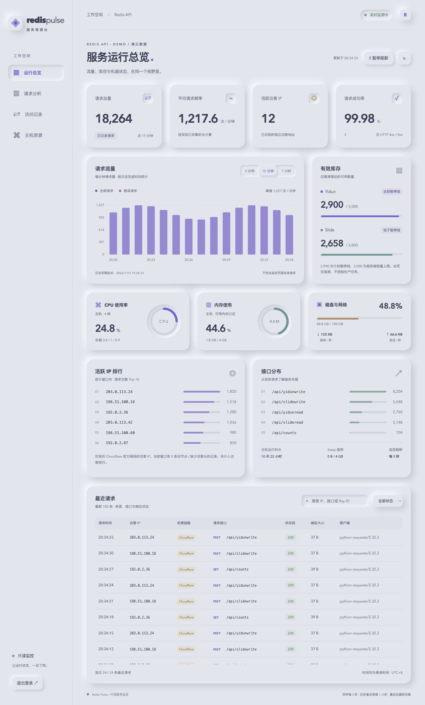
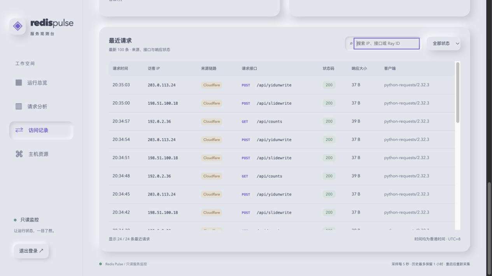

# Redis Pulse

为 `yiduns` 和 `slides` 提供有期限、去重的 Redis 库存接口，以及 Neumorphism 风格的只读监控台。

- 监控入口：`https://<你的域名>/monitor/`，使用独立访问密码。
- 每 5 秒更新请求频率、访客 IP、库存、CPU、内存、磁盘与网络状态。
- 队列容量上限 3,000 条，记录有效期 900 秒；查询数量前原子清理过期数据。
- 兼容 Cloudflare CDN：识别访客 IPv4 / IPv6，保留边缘节点地址与 Ray ID。

## 界面预览

以下截图使用演示数据和文档专用 IP，不包含线上访客信息或真实机器指标。

### 运行总览



顶部显示请求量、平均频率、活跃访客和成功率；柱状图支持最近 5 / 15 / 60 分钟。右侧是清理过期记录后的有效库存，下方显示主机资源、访客排行和接口分布。

> 2,900 暂停线仅作状态提示。监控台不会暂停、恢复或修改外部生产脚本。

### 请求记录与 Cloudflare 来源



支持按 IP、接口或 Ray ID 搜索，按成功 / 错误筛选。鼠标停在 **Cloudflare** 来源标签上，可查看边缘节点 IP 和 Ray ID。旧日志缺少访客 IP 时标记为“节点 · 未识别访客”，不混入访客排行。

## 接口

| 方法 | 路径 | 用途 |
| --- | --- | --- |
| POST | `/api/yidunwrite` | 写入 `token`、`validate`，返回 `code`、`count`、`inserted` |
| GET | `/api/yidunread` | 原子读取并删除一条可用数据；`type=1` 跳过最低库存限制 |
| POST | `/api/slidewrite` | 写入 Slide 数据，字段同上 |
| GET | `/api/slideread` | 原子读取并删除 Slide 数据 |
| GET | `/api/readnum?type=yiduns` | 查询 Yidun 有效库存，不消费有效数据 |
| GET | `/api/readnum?type=slides` | 查询 Slide 有效库存，不消费有效数据 |
| GET | `/api/counts` | 同时返回两种有效库存 |
| GET | `/monitor/api/snapshot?minutes=15` | 登录后获取监控数据；时间范围可为 5、15、60 |

## 部署

需要 Docker Compose 和可访问的 Redis。默认 API 与监控服务使用 host 网络，建议 Linux 服务器；Redis 不应向公网开放。

```bash
cp config.example config
cp monitor.env.example monitor.env
chmod 600 config monitor.env
# 编辑 Redis/API 参数，并为 monitor.env 填入新的随机 secret 与密码哈希。
docker compose -f docker-compose.yml -f compose.monitor.yml up -d --build
```

`MONITOR_SECRET` 是随机会话签名密钥；`MONITOR_PASSWORD_HASH` 使用 Werkzeug `generate_password_hash()` 生成，含 `$` 的哈希必须用单引号包裹。不要提交真实配置和密码。

在前置反向代理中把域名转发至 API 端口，默认 `16379`；监控服务仅监听 `127.0.0.1:16380`，通过 API 的 `/monitor/` 转发。登录 Cookie 默认仅允许 HTTPS。Redis 和监控服务无需暴露新的公网端口。

## Cloudflare 适配

日志记录 `X-Real-IP`、`CF-Connecting-IP`、`CF-Connecting-IPv6` 和 `CF-Ray`，但不会无条件信任这些头。

1. 直接访问 API 时，以实际 TCP 对端为来源，忽略外部伪造的转发头。
2. 经本机 Nginx 转发时，要求 Nginx 覆盖 `X-Real-IP` 为实际连接地址：`proxy_set_header X-Real-IP $remote_addr;`。不得原样信任访客传入的 `X-Real-IP`。
3. 仅在该地址属于 [Cloudflare 官方 IPv4](https://www.cloudflare.com/ips-v4) / [IPv6](https://www.cloudflare.com/ips-v6) 网段时，采用 `CF-Connecting-IP`。
4. 对 Pseudo IPv4 的 `Overwrite Headers` 模式，使用 `CF-Connecting-IPv6` 还原 IPv6 访客地址。
5. 缺少有效访客头的历史 CDN 记录仍计入请求量，但不计入访客 IP 排行。

网段保存在 `monitor/cloudflare.py`，需随 Cloudflare 官方网段变更更新。Worker 子请求、多层 CDN 等场景的 IP 含义以 [Cloudflare 官方说明](https://developers.cloudflare.com/fundamentals/reference/http-headers/) 为准，不应作为身份认证依据。若使用 Cloudflare 自定义强制缓存规则，应为 `/api/*` 与 `/monitor/*` 设置绕过缓存；监控接口已发送 `Cache-Control: no-store`。

## 数据口径与资源

- 请求按访问日志中的完成时间统计，HTTP `>=400` 计为错误；包含健康检查和库存轮询，不含 `/monitor` 自身请求。
- 首次最多读取当前日志末尾 8MB，之后增量读取并支持日志轮转。历史保留最多一小时，重启后重新采集，页面标出可用日志起点。
- 最近请求在内存中保留 500 条，接口最多返回 100 条；查询字符串不进入监控数据。
- CPU、可用内存、负载、运行时长来自主机 `/proc`；磁盘为日志所在文件系统，网络排除 loopback 与 Docker 虚拟接口。
- 独立监控容器限制 192MB 内存、0.5 CPU，不挂载 Docker socket，仅只读挂载日志和所需系统指标文件。

更多细节见 [监控说明](monitor/README.md)。

## 验证

```bash
python -m unittest monitor.test_monitor monitor.test_cloudflare test_monitor_proxy
RUN_REDIS_TESTS=1 python test_counts.py
node --check monitor/static/app.js
```

Redis 集成测试使用独立随机键并清理，不消费生产库存。
